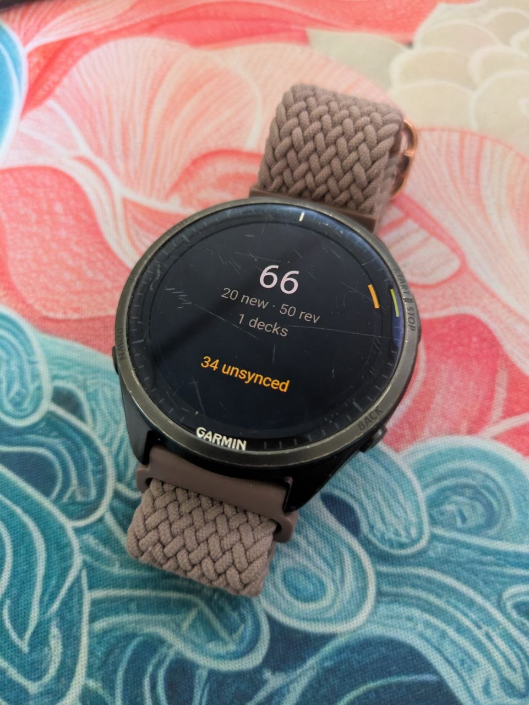
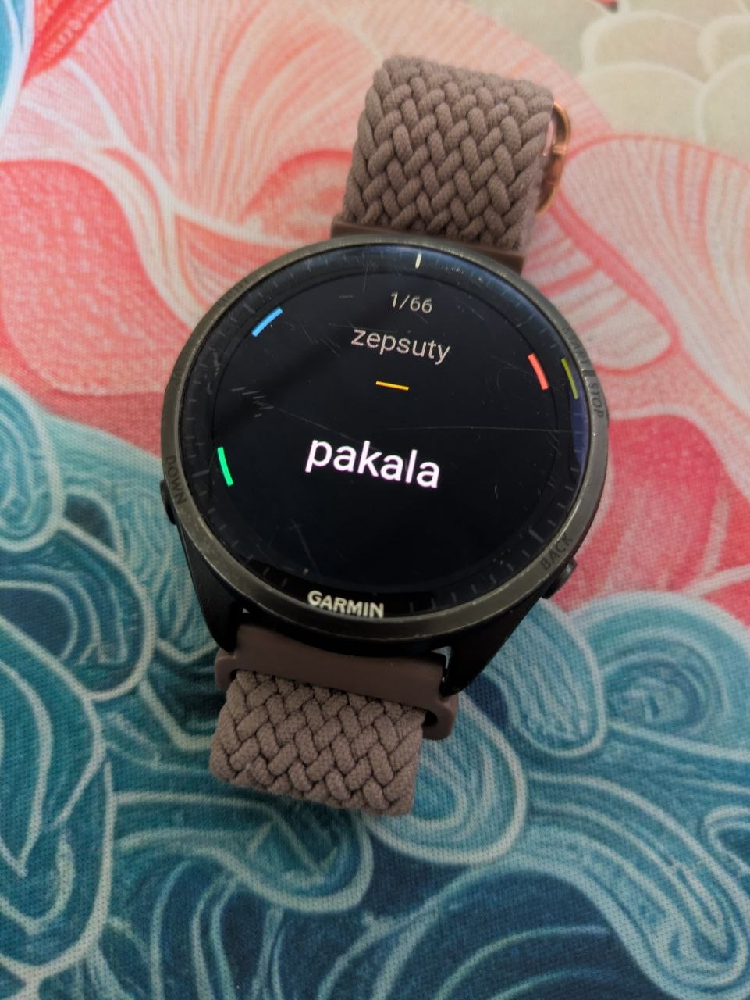
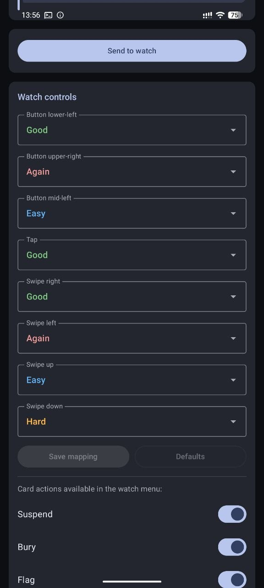

# garmanki

Unofficial Anki client for Garmin watches: a Connect IQ watch-app plus
an Android companion that bridges to [AnkiDroid](https://github.com/ankidroid/Anki-Android)
over Connect IQ BLE messaging. The scheduler stays in AnkiDroid — the
watch only shows cards and reports back how you did.

  
  
  

## Status

Publicly released:

- **Android companion** (v1.0.5) —
  [Google Play](https://play.google.com/store/apps/details?id=dev.sypianski.garmanki)
- **Watch app** (v1.3.0) —
  [Connect IQ Store](https://apps.garmin.com/apps/f3cb31bc-f5d9-4818-b730-4c67e98e3b7a)

garmanki is an independent project, not affiliated with Anki, AnkiDroid
or Garmin.

## Requirements

- An Android phone (Android 8+) with **AnkiDroid** and **Garmin Connect**
  installed on the same phone.
- A supported Garmin watch (below). Most models need Connect IQ 4.2.1+;
  the fēnix 6 Pro-class watches run API 3.4.

## Supported watches

Tested **only on the Forerunner 965**. The app is built for 45 watch
models (73 hardware variants, counted by Garmin part number); the other
models compile but have not been checked on real hardware.

- **Forerunner** — 165 / 165 Music, 255 / 255s (and Music), 265 / 265s,
  570 (42 / 47 mm), 955, 965, 970
- **fēnix** — 6 Pro-class (6 Pro, 6S Pro, 6X Pro, incl. Sapphire / Solar /
  Dual Power), 7 / 7S / 7X (and Pro), 8 (43 / 47 / 51 mm, incl. Solar), E
- **epix** — epix (Gen 2); epix Pro (Gen 2) 42 / 47 / 51 mm
- **Venu** — 2 / 2S / 2 Plus, 3 / 3S, 4 (41 / 45 mm)
- **vívoactive** — 5, 6
- **MARQ** — MARQ (Gen 2); MARQ Aviator (Gen 2)
- **Enduro** — 3
- **Instinct** — 3 AMOLED (45 / 50 mm)

Plain fēnix 6 / 6S (128 KB app RAM) are **not** supported yet.

## Limitations (v1)

- Text only: no images or audio on the watch; cloze deletions show as
  `[...]`.
- Latin script (including Polish) is what the app is built for. Tested
  on a Forerunner 965 only: Arabic is drawn joined and right-to-left,
  and since companion 1.0.5 vowel marks (harakat) display correctly too
  (the companion converts the letters to presentation forms before
  sending). Modern Greek and precomposed Latin diacritics
  (ā ḥ ṣ ḍ ṭ ẓ …) display correctly; the companion composes combining
  marks. Polytonic Greek and some rarer Latin letters (ǫ ɛ ɔ ʃ) show as
  placeholder boxes, and lam-alef is drawn as two letters instead of a
  ligature. CJK has not been tested; other watches have not been verified.
- Needs an Android phone with the Garmanki companion and AnkiDroid:
  without them the watch has no cards to show (it displays "No data").
- Android only: there is no iOS companion. Its feasibility is being
  researched; there is no decision or timeline.

## Layout

| Dir | What | Stack |
|---|---|---|
| `watch/` | Connect IQ app (45 models / 73 hw variants incl. fenix6 Pro-class; minApiLevel 3.4.0) | Monkey C, SDK 9.x |
| `android/` | companion — AnkiDroid bridge + BLE push | Kotlin, Compose M3, CIQ Mobile SDK 2.4.0 |

See [SCHEMA.md](SCHEMA.md) for the watch↔phone data contract and
[DECYZJE.md](DECYZJE.md) for product decisions. The source is public:
<https://github.com/sypianski/garmanki>.

## License

[MIT](LICENSE) © 2026 Jakub Sypiański. Third-party components (the Space Mono
font) keep their own licenses, see [THIRD-PARTY-NOTICES.md](THIRD-PARTY-NOTICES.md).
